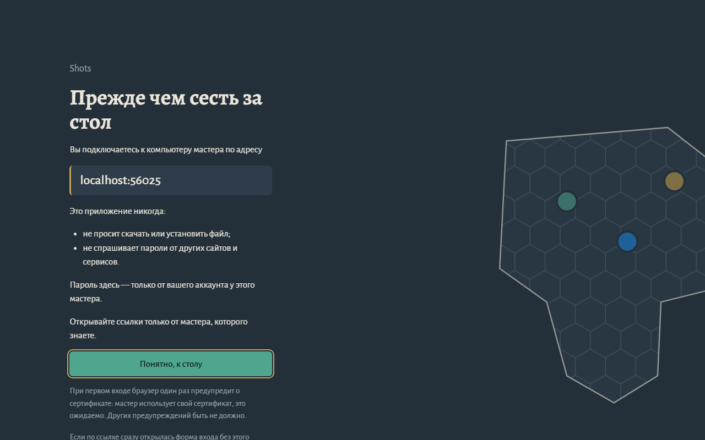

# dnd-vtt (рабочее название)

Автономный сервис для проведения D&D-сессий онлайн. Мастер скачивает и запускает **одно приложение**, а игрокам отправляет ссылку. Игроки заходят из браузера, ничего не устанавливая.

## Системы

| # | Система | Документ |
|---|---------|----------|
| 1 | Виртуальный стол: сцены, карты, фишки, туман войны, кубики | [docs/systems/vtt.md](docs/systems/vtt.md) |
| 2 | Встроенный голосовой чат с камерами | [docs/systems/voice-video.md](docs/systems/voice-video.md) |
| 3 | Интерактивный лист персонажа (D&D 5e 2024, SRD 5.2) | [docs/systems/character-sheet.md](docs/systems/character-sheet.md) |
| 4 | Документация кампании (вики мастера в стиле Notion) | [docs/systems/gm-wiki.md](docs/systems/gm-wiki.md) |
| 5 | MCP-сервер для ИИ-ассистента мастера | [docs/systems/mcp-server.md](docs/systems/mcp-server.md) |

Плюс общая библиотека контента на GitHub: [docs/systems/content-library.md](docs/systems/content-library.md).

## Как это работает

```
 Мастер (Windows)                              Игроки (браузер)
┌───────────────────────────────┐
│ dnd-vtt.exe                   │  HTTPS/WSS  ┌──────────┐
│  ├─ HTTP + встроенный клиент  │◄────────────┤ Игрок 1  │
│  ├─ WebSocket (состояние игры)│             └──────────┘
│  ├─ SFU (голос/видео, WebRTC) │  UDP/TCP    ┌──────────┐
│  ├─ TURN (фолбэк)             │◄────────────┤ Игрок N  │
│  └─ SQLite + папка ассетов    │             └──────────┘
└───────────────────────────────┘
      ▲ проброс портов на роутере ИЛИ встроенный туннель
```

Подробнее: [docs/architecture/overview.md](docs/architecture/overview.md).

## Статус

Этап **M0 Foundation**: собирается фундамент (сервер, клиент, хранилище, протокол). План — в [docs/roadmap.md](docs/roadmap.md).

## Безопасность для игроков

Код приложения открыт, и кто угодно может собрать изменённую версию. Поэтому:

- Каждый раз, когда вы открываете ссылку на игру, **до входа** показывается экран безопасности с адресом мастера и правилами. Если по ссылке сразу открылась форма входа без этого экрана — версия изменена, закройте страницу и сообщите мастеру.
- Приложение **никогда** не просит скачать или установить файл и **никогда** не спрашивает пароли от других сайтов и сервисов. Пароль, который вы вводите, — только от аккаунта у этого мастера.
- При первом входе по HTTPS браузер один раз предупредит о сертификате: мастер использует самоподписанный сертификат ([ADR-0015](docs/adr/0015-lan-https-self-signed.md)). Других предупреждений быть не должно.
- Открывайте ссылки только от мастера, которого знаете. Мастеру — скачивайте приложение только со страницы релизов этого репозитория.

Так выглядит экран (адрес и название кампании у вас будут свои):



Подробно — [security.md](docs/architecture/security.md#экран-безопасности-для-игрока).

## Локальная разработка

Нужны Go 1.26+, Node.js 22.12+ и pnpm 10.

```powershell
pnpm -C web install
go run ./cmd/dndvtt -dev        # сервер на http://localhost:7777
pnpm -C web dev                 # клиент с hot reload на http://localhost:5173
```

Сборка одного бинарника со встроенным клиентом:

```powershell
pnpm -C web build
$env:CGO_ENABLED = "0"; go build -o bin/dndvtt.exe ./cmd/dndvtt
```

## Для разработчиков и агентов

- Правила работы: [CLAUDE.md](CLAUDE.md)
- Оглавление документации: [docs/README.md](docs/README.md)
- Процесс: [docs/process/workflow.md](docs/process/workflow.md)

## Лицензии

Код проекта распространяется под [GNU AGPL-3.0-or-later](LICENSE): если вы изменили программу и даёте к ней доступ другим людям (в том числе по сети), вы обязаны открыть исходный код своей версии. Почему выбрана эта лицензия: [ADR-0007](docs/adr/0007-license-agpl-3.md).

Игровой контент взят из SRD 5.2 (CC-BY-4.0), см. [NOTICE](NOTICE).
