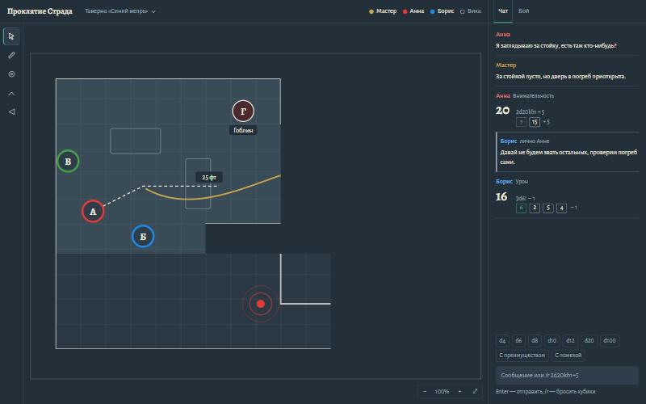
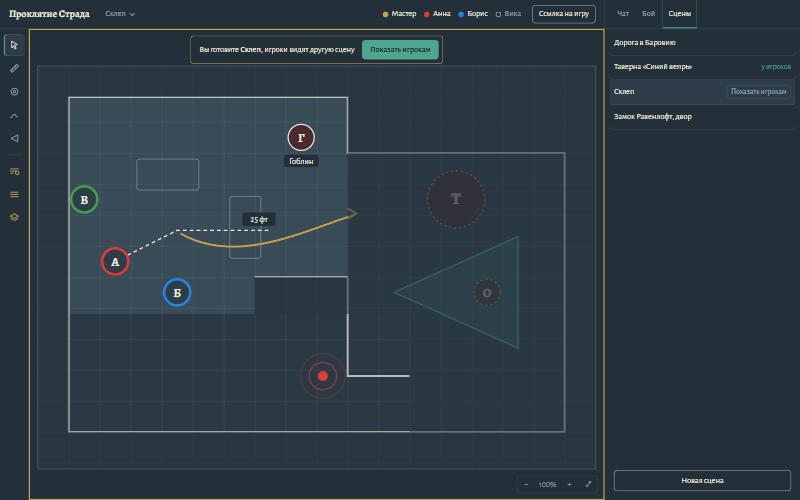
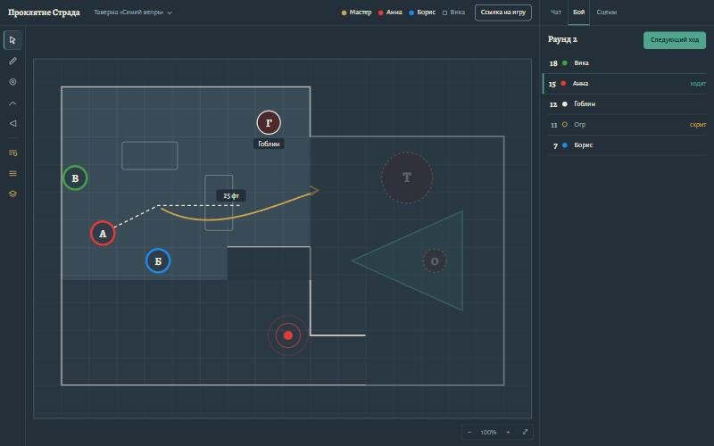
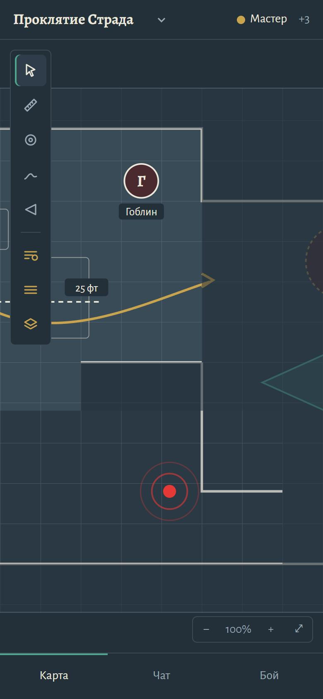

# Экран стола

> Статус: `review`. Общие токены, шрифты и принципы — [visual-language.md](visual-language.md); процесс — [skills/frontend.md](../../skills/frontend.md); холст — [ADR-0012](../adr/0012-pixijs-scene-canvas.md); данные — [protocol.md](../architecture/protocol.md) («Сообщения M1: стол»).

## Предмет и задача

Экран, за которым проходит вся игра: часы подряд, вечером, часто на ноутбуке. Игроку нужно видеть карту, свою фишку, чат с бросками и чей ход. Мастеру нужно ещё готовить следующую сцену, не показывая её игрокам, управлять туманом и скрытыми фишками. Главная работа экрана — не мешать карте.

## План

### Цвет
Новых цветов нет: только токены `visual-language.md`. Одно добавление — `--line: rgba(154, 168, 179, .22)`, `--fog` на 22%: разделители и рамки, которые не должны спорить с картой.

| Где | Цвет |
|-----|------|
| Фон вокруг сцены, туман у игрока (сплошной) | `--slate` — тот же «туман», что на экранах входа: карта раскрывается из фона страницы |
| Туман у мастера | `--slate` с прозрачностью 55% |
| Поверхность сцены без фона, плашки подписей | `--board` / `--slate` |
| Линии сетки | `--fog` на 28% |
| Обводка фишки | цвет владельца из палитры игроков, 4 px; фишки без владельца — `--chalk`, 2 px |
| Всё, что видит только мастер (слой `gm`, скрытые фишки, участники боя, броски «только мастеру», рамка подготовки) | `--brass`; скрытые фишки — пунктир и 60% прозрачности |
| Текущий выбор (инструмент, ход в бою, вкладка) | `--verdigris`: полоса 2–3 px с внутренней стороны |
| Рисунки и стрелки | цвет, выбранный автором; по умолчанию — цвет участника |
| Шаблоны областей | `--verdigris`, заливка 18% |

### Шрифты
- **Alegreya 700:** название кампании (18 px), итог броска (31 px), номер инициативы и раунд (18 px), буква на фишке без изображения.
- **Alegreya Sans:** всё остальное; 15 px — панель и подписи, 14 px — второстепенное (формула, «лично Анне»).
- Подписи на холсте (имя фишки, «25 фт» у линейки) — Alegreya Sans 14 px на плашке `--slate` со скруглением 4 px: читаются на любом фоне карты.

### Раскладка

```
┌──────────────────────────────────────────────────────────────┬───────────────┐
│ Проклятие Страда   Таверна ▾        ● Мастер ● Анна ○ Вика  [Ссылка] │ Чат  Бой  Сцены │
├──┬───────────────────────────────────────────────────────────┼───────────────┤
│▸ │                                                           │ Анна          │
│📏│                                                           │ Я заглядываю… │
│◎ │                     холст сцены                           │ ───────────── │
│〜│              (панорама, зум, туман)                       │ Анна  Внимат. │
│◁ │                                                           │ 20  2d20kh1+5 │
│──│                                                           │     ⃞7 15 +5  │
│▤ │  (инструменты мастера — латунные)                         │               │
│▦ │                                                [− 100% + ⤢] │ d4 d6 … d100  │
│◇ │                                                           │ [сообщение  ] │
└──┴───────────────────────────────────────────────────────────┴───────────────┘
   52 px                          остаток                          22rem
```

- **Верхняя полоса, 52 px:** название кампании; выбор сцены (у игрока — только название активной, без списка); участники — точка цвета и имя, не в сети — пустой кружок и `--fog`; у мастера справа «Ссылка на игру».
- **Полоса инструментов слева, 52 px:** выбрать и двигать, линейка, пинг, рисование, шаблон; ниже разделителя — инструменты мастера: раскрыть туман, скрыть туманом, слой мастера. У каждой кнопки `aria-label`, подсказка с клавишей и `aria-pressed`.
- **Холст** занимает всё остальное. В правом нижнем углу — масштаб: «−», процент, «+», «Показать всю сцену».
- **Панель справа, 22rem:** вкладки «Чат», «Бой», у мастера — «Сцены». Это ряды с разделителями, не карточки.
- **Ниже 900 px:** панели нет. Снизу — вкладки разделов «Карта», «Чат», «Бой»; «Чат» и «Бой» открываются на весь экран. Инструменты — плавающий столбик в левом верхнем углу карты; в верхней полосе — название кампании и первый участник с «+N».
- Всё выровнено по левому краю; по центру — только плашка подготовки сцены над холстом.

### Выразительная деталь: мастер готовит сцену
Когда мастер смотрит не ту сцену, что видят игроки, холст обведён изнутри латунной рамкой 2 px. Над ним — плашка: «Вы готовите **Склеп**, игроки видят другую сцену» и кнопка «Показать игрокам». Это единственный громкий элемент экрана, и он отвечает на главный риск мастера — показать игрокам не то. Остальное тихо.

### Холст: как выглядит содержимое
- **Фишка с изображением:** круглая маска, обводка цветом владельца. **Без изображения:** круг `--board` (для врагов — тёмно-красный `#4a2a2f`), первая буква имени — Alegreya 700. Размер — по `w`/`h` в клетках.
- **Имя:** по `nameVisibility` — всегда, при наведении или только мастеру; плашка под фишкой.
- **Полоски** (HP и др.) — тонкие, 4 px, над фишкой: заполнение `--verdigris`, при ≤ 25% — `--seal`.
- **Выбранная фишка** — пунктирная рамка `--chalk` вокруг; при перетаскивании виден «призрак» исходного положения и подпись расстояния, как у линейки.
- **Линейка** — пунктир `--chalk` 2 px по центрам клеток, на конце плашка с расстоянием в футах (диагонали по правилам 2024: каждая — 5 фт). Чужая линейка — тем же стилем, цвета её автора.
- **Пинг** — точка цвета автора и два расходящихся кольца (1.2 с, один раз); при `prefers-reduced-motion` — статичные кольца на 2 с.
- **Туман у мастера** — полупрозрачный `--slate`: видно и раскрытое, и то, что скрыто.
- **Рамка сцены** — линия `--fog` 35%: видно, где кончается карта.

### Панель «Чат»
- Сообщение — ряд: имя автора цветом участника (500), рядом мелко — метка броска или «лично Анне»; ниже — текст.
- **Бросок:** итог — Alegreya 700 31 px слева; справа две строки: формула (`--fog`, 14 px) и кости — маленькие плашки с обводкой. Отброшенные — зачёркнуты и приглушены; максимум грани — `--verdigris`; взорвавшиеся — с пометкой «!». Видимость, кроме `public`, — словами в `--brass`: «только мастеру», «себе», «втёмную». У автора броска «втёмную» вместо итога — «?» и «результат у мастера».
- **Личное сообщение** — полоса 3 px `--fog` слева и «лично: Анне, Борису».
- Снизу — быстрые броски (`d4`…`d100`, «С преимуществом», «С помехой») и поле «Сообщение или /r 2d20kh1+5» с подсказкой «Enter — отправить, /r — бросить кубики». Ошибка формулы — под полем, `--seal`, текстом ошибки разбора по-человечески («Не понял формулу: после “+” нужно число или кубик»).

### Панель «Бой»
- Сверху «Раунд 2» (Alegreya 700 18 px) и кнопка «Следующий ход»: у мастера всегда, у игрока — только в его ход.
- Ряды в порядке ходов: инициатива (Alegreya 700), точка цвета, имя. Текущий ход — полоса `--verdigris` 3 px слева и подпись «ходит». Скрытые участники (видит только мастер) — `--fog`, пустой латунный кружок и «скрыт».
- Нет боя — пустое состояние с действием: у мастера «Начать бой» («Выделите фишки на карте и добавьте их в бой»), у игрока — «Боя нет».

### Панель «Сцены» (мастер)
- Ряды сцен по порядку. Активная — подпись «у игроков» `--verdigris`; та, что сейчас на холсте у мастера, — фон `--board`; у неё и при наведении на другие — кнопка «Показать игрокам».
- Внизу — «Новая сцена». Переименование, фон, сетка и удаление — в меню ряда (детали — в задаче управления сценами).

## Проверка плана против брифа

Что было «по умолчанию» и что изменено после проверки:
- **Карточки для сообщений чата и участников боя** — типичный набор SaaS-интерфейса. Заменены рядами с разделителями: это журнал, а не галерея.
- **Отдельный «тёмный режим с неоновым акцентом» для холста.** Холст продолжает язык экранов входа: туман — это сам фон страницы, поэтому карта «проявляется» из интерфейса.
- **Плашка подготовки сцены** сначала повторяла оба названия в кавычках («Игроки видят «Таверна «Синий вепрь»»…»): вложенные кавычки читались плохо. Теперь короткая фраза о том, что сделать.
- **Мобильный вид** в первом варианте прятал чат без способа его открыть. Добавлены вкладки разделов внизу.
- **Иконки** — свои SVG в одну линию 1.6 px (`stroke: currentColor`), без библиотеки иконок и без новых зависимостей.

## Доступность
- Всё, что есть на холсте и важно для игры, дублируется вне холста: участники и их онлайн — в верхней полосе, ход — в «Бое», броски и пинги — в чате и через `aria-live="polite"` («Анна поставила метку на карте»).
- Клавиатура: инструменты — клавишами (V, R, P, D, T; мастеру — F, Shift+F, G); выбранная фишка двигается стрелками на клетку; Escape снимает выбор и закрывает меню.
- Фокус — `2px solid var(--brass)`, как везде; на холсте — у выбранной фишки.
- `prefers-reduced-motion`: без анимации пинга и тумана; перемещения чужих фишек — сразу, без интерполяции.
- Контраст текста — не ниже WCAG AA на `--slate` и `--board`.

## Скриншоты макета

Макет — статичный HTML (холст нарисован SVG), только для проверки раскладки и тона; это не код продукта.

| Вид | Файл |
|-----|------|
| Игрок, 1440×900: туман, фишки, линейка, рисунок, пинг, чат с бросками и личным сообщением |  |
| Мастер готовит другую сцену, вкладка «Сцены» |  |
| Мастер, вкладка «Бой» со скрытым участником, туман полупрозрачный |  |
| Мастер, 390×844 |  |
