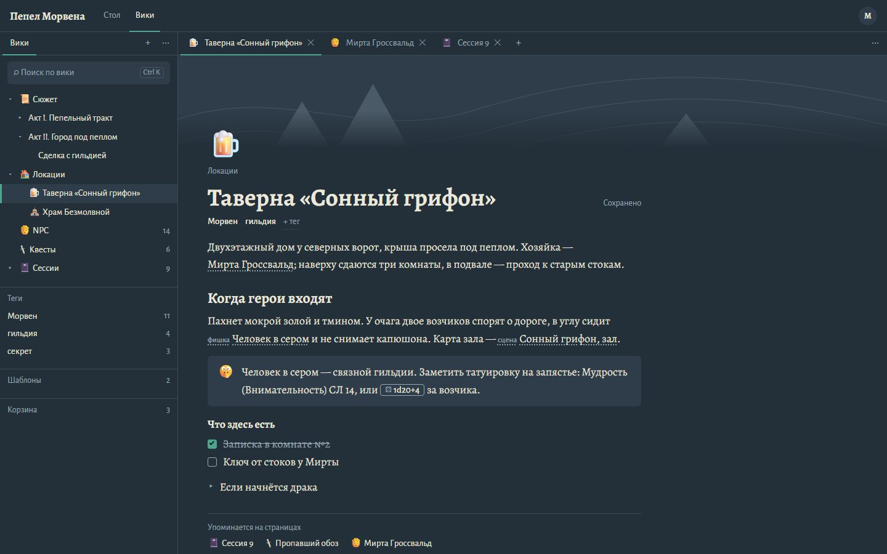
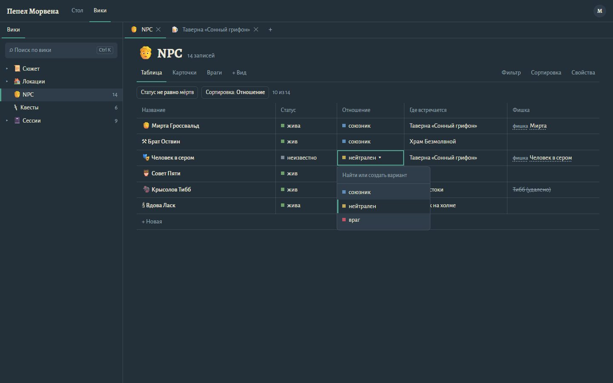
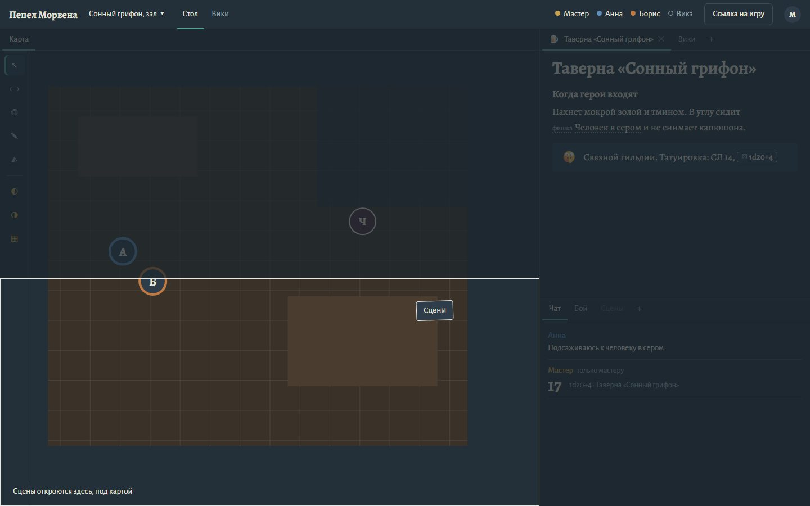
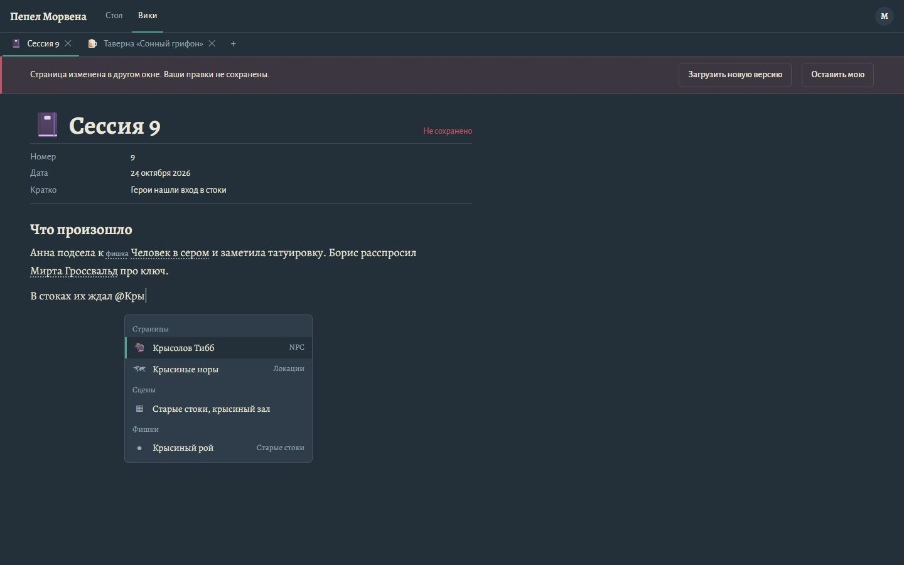
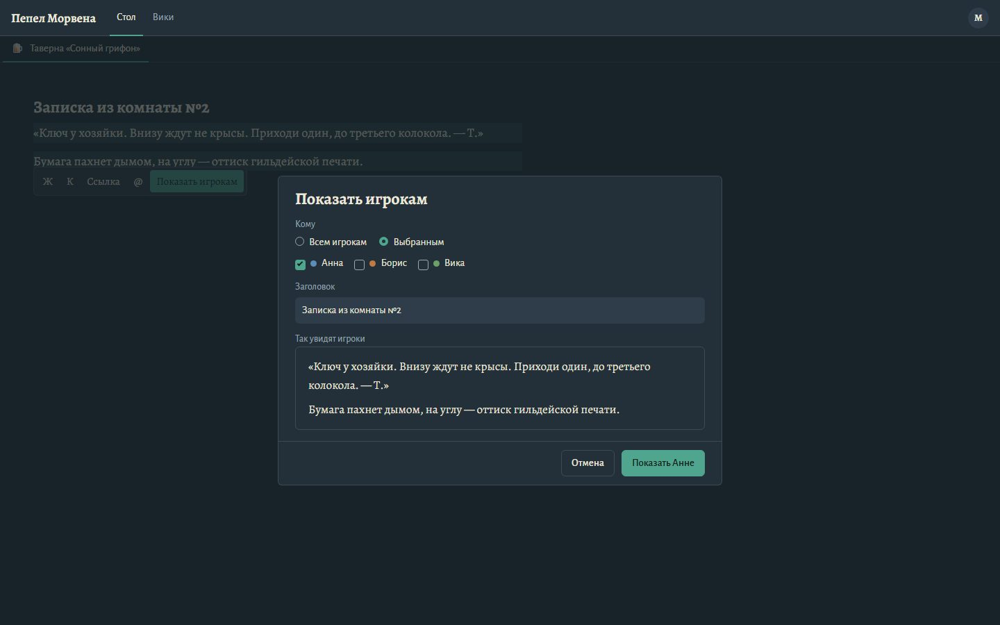
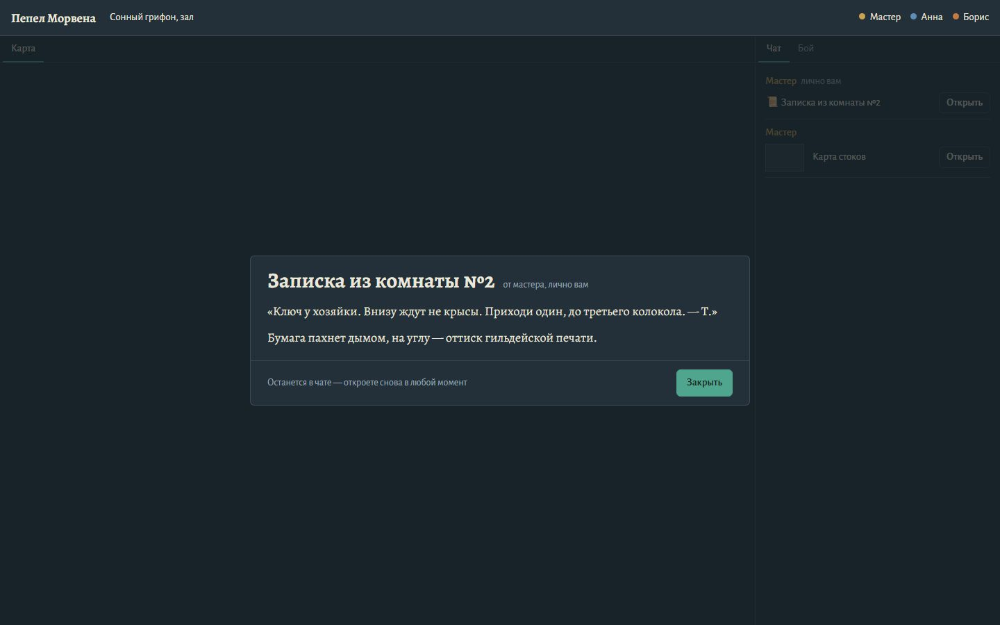
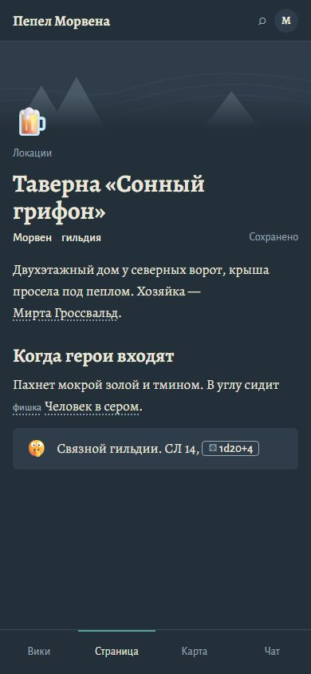

# Вики и рабочая область

> Статус: `review`. Общие токены, шрифты и принципы — [visual-language.md](visual-language.md), экран стола — [table-screen.md](table-screen.md); процесс — [skills/frontend.md](../../skills/frontend.md). Поведение — [gm-wiki.md](../systems/gm-wiki.md), [workspace.md](../architecture/workspace.md).

## Предмет и задача

Тетрадь мастера рядом со столом. Её используют двумя способами. В будни, при подготовке, мастер спокойно пишет страницы, заводит NPC и квесты. Вечером, во время игры, нужно за секунды найти страницу, прочитать абзац «когда герои входят», бросить проверку и показать игрокам записку. Поэтому текст страницы должен читаться как книга, а всё вокруг — не отвлекать от стола.

## План

### Цвет
Новых основных цветов нет: токены `visual-language.md` и `--line` из экрана стола. Добавляется палитра вариантов `select` — восемь приглушённых цветов, различимых на `--slate`:

| Имя (`color`) | Hex | | Имя | Hex |
|---------------|-----|-|-----|-----|
| `gray` | `#7D8B96` | | `green` | `#6E9F6A` |
| `brown` | `#9A7458` | | `blue` | `#5E8DB8` |
| `orange` | `#C27A43` | | `purple` | `#8E78B5` |
| `yellow` | `#BFA85A` | | `red` | `#C25468` (`--seal`) |

| Где | Цвет |
|-----|------|
| Текущий выбор: вкладка, строка дерева, пункт меню, редактируемая ячейка | `--verdigris`, полоса 2–3 px (как на столе) |
| Главное действие: «Показать игрокам», «Показать Анне» | `--verdigris` с `--ink-on-verdigris` |
| Конфликт версий, «Не сохранено» | `--seal`: полоса 3 px слева у плашки, фон `--seal` 16% |
| Выноска, поле ввода, меню | `--board` |
| Выделение текста для handout'а | `--verdigris` 22% |
| Туман рабочей области при перетаскивании | `--slate` 72% поверх всего, кроме цели |

### Шрифты
- **Текст страницы — Alegreya 400, 18 px / 1.6.** Мастер пишет повествование и читает его вслух: засечки здесь уместнее, чем в интерфейсе. Колонка — до 44rem (≈ 70 знаков).
- **Alegreya 700:** название страницы 40 px (31 px — в узкой панели и на телефоне), заголовки 24 / 18 px, название базы 31 px, заголовок handout'а 31 px, название карточки 17 px.
- **Alegreya Sans:** всё остальное — дерево, вкладки, таблицы баз, меню, свойства (15 px; второстепенное — 14 px).
- Код в блоке `codeBlock` — системный моноширинный шрифт, только там.

### Раскладка

Экран вики (`/wiki/<campaignId>`):

```
┌ Пепел Морвена   Стол  Вики ─────────────────────────────────────────── (М) ┐
├ Вики       + ⋯ ┬ 🍺 Таверна ✕ │ 🧔 Мирта ✕ │ 📓 Сессия 9 ✕  +          ⋯ ┤
│ [⌕ Поиск  Ctrl K]│ ░░░░░░░░░░░ обложка 150 px ░░░░░░░░░░░░░░░░░░░░░░░░ │
│ ▾ 📜 Сюжет      │ 🍺                                                    │
│   ▸ Акт I       │ Локации                                               │
│ ▾ 🏠 Локации    │ Таверна «Сонный грифон»                 Сохранено     │
│ ┃ 🍺 Таверна    │ Морвен  гильдия  + тег                                │
│ 🧑 NPC      14  │ Текст страницы (Alegreya 18), колонка до 44rem…       │
│ ─ Теги          │ ┌🤫 выноска ─────────────────────────┐                │
│ ─ Шаблоны    2  │ └──────────────────────────────────┘                │
│ ─ Корзина    3  │ ─ Упоминается на страницах: 📓 Сессия 9 …           │
└─────────────────┴──────────────────────────────────────────────────────┘
      18rem                       остаток
```

- **Верхняя полоса** — как у стола, 52 px; переключатель «Стол | Вики» — подчёркнутые ссылки (текущая — полоса `--verdigris`). «Стол» виден, только когда идёт игра.
- **Вкладки групп** — текст 15 px с иконкой страницы, полоса `--verdigris` 2 px снизу у текущей, крестик «✕» `--fog`. Не «вкладки браузера» с рамками: ряд вкладок — это строка оглавления, а не ряд карточек.
- **Разделители групп** — 1 px `--line`; при наведении — 2 px `--verdigris`.
- **Дерево** — ряды по 30 px, отступ 16 px на уровень, число записей у базы справа `--fog`. Разделы «Теги», «Шаблоны», «Корзина» отделены линией, подпись раздела — 14 px `--fog`, без капса.
- **Страница выровнена по левому краю** с полем 48 px, как всё в приложении; не центрированная колонка.
- **Шапка страницы:** обложка 150 px (затухает в `--slate` снизу), иконка 44 px, путь родителей 14 px, название, справа — индикатор сохранения; ниже — теги словами 500 и «+ тег» с пунктиром.
- **Свойства записи** — две колонки «имя | значение» между тонкими линиями, над текстом.
- **Обратные ссылки** — внизу, под линией: «Упоминается на страницах» и страницы в строку.
- **На столе** панели вики выглядят так же, но с полем 22 px и названием 31 px.
- **Ниже 900 px:** рабочей области нет; страница на весь экран (поле 16 px), внизу — вкладки разделов «Вики», «Страница», «Карта», «Чат» (на экране вики без игры — только первые две).

### Выразительная деталь: рабочая область раскрывается из тумана
Когда вкладку тащат, вся рабочая область уходит под «туман» (`--slate` 72%), а то место, куда панель встанет, остаётся **ясным** и обведено линией `--chalk` 1.5 px — тот же жест, что на экранах входа и на столе, где карта проявляется из тумана. Внизу ясной области — подпись словами: «Сцены откроются здесь, под картой». Переход тумана — 120 мс, при `prefers-reduced-motion` — без перехода. Это единственный громкий элемент; остальное тихое.

### Содержимое страницы
- **Упоминание** — текст `--chalk` с точечным подчёркиванием `--fog`. У сцены и фишки перед именем — подпись 13 px `--fog` «сцена» / «фишка»; у страницы подписи нет (это обычный случай). Удалённое — `--fog`, зачёркнуто, «(удалено)».
- **Инлайн-бросок** — кнопка в строке: рамка 1 px `--fog`, скругление 4 px, значок кубика и формула Alegreya Sans 500 15 px. Вне игры — `--fog` без рамки и подсказка «Бросить можно во время игры».
- **Выноска** — фон `--board`, скругление 6 px, эмодзи слева, без рамки и тени.
- **Чек-лист** — квадрат 15 px с обводкой `--fog`; отмеченный — заливка `--verdigris`, текст пункта `--fog` зачёркнут.
- **Сворачиваемый блок** — треугольник `▸` `--fog` и заголовок; раскрытый — `▾` и содержимое с отступом 22 px.
- **Ручка блока** (⋮⋮) — слева от блока при наведении, `--fog`.
- **Плавающая панель выделения:** «Ж», «К», «Ссылка», «@» и «Показать игрокам» (только во время игры) — последняя кнопка `--verdigris`.

### Базы данных
- Заголовок базы — иконка и название 31 px, рядом «14 записей» `--fog`.
- Виды — вкладки как у групп; справа «Фильтр», «Сортировка», «Свойства».
- Активные фильтры и сортировка — строкой условий под видами (рамка `--line`, скругление 6 px — это кнопки, открывающие правку условия), справа «10 из 14».
- **Таблица** — сетка линий `--line`, без заливки строк и «зебры». Название записи — 500. Редактируемая ячейка — рамка `--verdigris` 2 px внутри.
- **Вариант `select`** — квадрат 8 px цвета варианта и слово, без «таблеток». Квадрат — как метка на полях тетради; таблетки превратили бы таблицу в пёстрый набор кнопок.
- **Карточки** — сетка от 210 px, рамка `--line`, скругление 6 px, без тени: обложка 96 px, название Alegreya 700 17 px, свойства 14 px `--fog`.

### Handout
- Диалог мастера «Показать игрокам»: кому (радио «Всем игрокам» / «Выбранным» и флажки участников с их цветом), заголовок, **«Так увидят игроки»** — предпросмотр тем же оформлением, что у игрока. Главная кнопка называет действие и адресата: «Показать всем», «Показать Анне», «Показать 2 игрокам».
- У игрока — окно по центру (до 720 px): заголовок Alegreya 700 31 px и «от мастера, лично вам» / «от мастера»; текст Alegreya 18 px; внизу «Останется в чате — откроете снова в любой момент» и «Закрыть». Изображение — по ширине окна, щелчок открывает его на весь экран.
- В чате — ряд: «Мастер», метка «лично вам» (если личный), значок свитка или миниатюра изображения, заголовок и кнопка «Открыть».

### Меню и состояния
- **`@`-меню и `/`-меню** — панель `--board` 300 px под курсором: группы с подписью 13 px `--fog` («Страницы», «Сцены», «Фишки»), справа у пункта — родитель или шорткат `--fog`; текущий пункт — фон `--slate` и полоса `--verdigris`. Клавиши ↑ ↓ Enter Esc.
- **Конфликт версий** — плашка под вкладками на всю ширину страницы: «Страница изменена в другом окне. Ваши правки не сохранены.» и кнопки «Загрузить новую версию», «Оставить мою».
- **Пустые состояния:** группа без страниц — «Выберите страницу в дереве или создайте новую» и кнопка «Новая страница»; пустая база — «Записей пока нет» и «+ Новая»; пустая корзина — «Корзина пуста»; поиск без результатов — «Ничего не нашлось. Проверьте написание или поищите по тегу».
- **Ошибки сохранения** — «Не сохранено» `--seal` и «Повторить» рядом; текст причины — в подсказке.

## Проверка плана против брифа

Что было «по умолчанию» и что изменено после проверки:
- **Клон Notion** (светлый фон, Inter, серый сайдбар) — первое, что приходит на «вики в стиле Notion». Вместо этого вики живёт на том же «сланце», что стол, а текст страницы набран Alegreya: это тетрадь мастера в его же комнате, а не офисный документ.
- **Цветные «таблетки» для `select`** — типичный приём баз данных. Заменены квадратом-меткой и словом: таблица остаётся читаемой, цвет служит различию, а не украшению.
- **Вкладки в стиле браузера** с рамками и скруглением сверху — заменены подчёркиванием, как вкладки панелей стола; группы разделяет одна линия.
- **Зона сброса как синий полупрозрачный прямоугольник** (поведение dockview по умолчанию) — заменена туманом с ясной целью: тот же жест, что во всём приложении.
- **Плашка конфликта сначала была латунной** — но латунь у нас значит «видно только мастеру». Конфликт — это ошибка сохранения, поэтому `--seal`.
- **Экран редактора сначала показывал `@`- и `/`-меню одновременно** — на скриншоте они спорили друг с другом; на макете оставлено одно (`@`), `/`-меню оформлено так же.
- **Подпись «стр.» у упоминания страницы** — лишний шум в самом частом случае; подпись осталась только у сцены и фишки.

## Доступность
- Дерево — `role="tree"` / `treeitem` с `aria-expanded`, стрелки ←↑→↓, Enter открывает страницу; перемещение страниц с клавиатуры — «Переместить…» в меню строки (выбор нового родителя поиском).
- Вкладки и группы — по [workspace.md](../architecture/workspace.md#доступность); меню вкладки и «+» доступны с клавиатуры.
- Упоминание и инлайн-бросок — кнопки (`role="link"` / `button`) с понятным `aria-label`: «Сцена Сонный грифон, зал», «Бросить 1d20+4».
- Таблица базы — `role="grid"`, переход по ячейкам стрелками, Enter — правка, Esc — отмена.
- Окно handout'а — `role="dialog"`, `aria-modal`, фокус на «Закрыть», Esc закрывает; заголовок связан через `aria-labelledby`; поступление handout'а объявляется `aria-live="polite"`: «Мастер показал вам: Записка из комнаты №2».
- Контраст текста — не ниже WCAG AA; цвета вариантов `select` всегда дублируются словом.
- `prefers-reduced-motion`: без перехода тумана и анимаций меню.

## Скриншоты макета

Макет — статичный HTML с теми же шрифтами, только для проверки раскладки и тона; это не код продукта.

| Вид | Файл |
|-----|------|
| Экран вики, 1440×900: дерево с разделами, три страницы вкладками, страница с обложкой, упоминаниями, броском, выноской, чек-листом, обратными ссылками |  |
| База NPC: вид «Таблица», условия фильтра, редактирование варианта `select` |  |
| Стол мастера в рабочей области: холст, страница вики, чат; вкладку «Сцены» тащат под карту — туман и ясная цель |  |
| Конфликт версий и `@`-меню упоминаний |  |
| Мастер показывает выделенный отрывок Анне |  |
| Игрок получил handout; в чате он остаётся с кнопкой «Открыть» |  |
| Страница вики, 390×844 |  |
